 

 

## 👾 About me

- 🧠 I build **AI products end to end** - the part people use, and the systems that keep it running
- 🤖 Most of my work right now: **AI agents, voice AI, and reliable backends**
- 🎯 Open to **Applied AI, Forward Deployed, Full-Stack and Backend** roles - India or remote
- ✈️ When I'm not coding, I'm probably watching planes

 

## 🕹️ Featured work

<table>
<tr>
<td width="33%" valign="top">

### 🎙️ Sargosh
**AI dictation app for Windows**

Hold a shortcut, speak, and clean text lands in any app. Works in **English, Hindi and Hinglish**, and an LLM cleans up fillers and self-corrections.

⚡ Cut the wait after speaking from **~10-12s to ~2.5-3.5s**

</td>
<td width="33%" valign="top">

### ☁️ Nimbus
**Cloud coding agent**

Give it a task in plain English. It reads your GitHub repo, makes the change in a **secure sandbox**, checks it, and opens a **pull request**.

🔁 Pause, resume, update and merge PRs, all from one session

</td>
<td width="33%" valign="top">

### 🚨 WakeOps
**Incident response platform**

Turns Grafana alerts into incidents and **calls the on-call engineer**. No answer? It retries, then escalates to a senior.

📨 Slack and email run through **RabbitMQ**, so they never block the calls

</td>
</tr>
</table>

<b>🧩 More projects</b>

 

| Project | What it does | Built with |
|---|---|---|
| 💬 **YapIt** | Real-time chat built as separate microservices | Next.js, Socket.io, RabbitMQ, Redis, AWS |
| 📊 **Revuea** | Anonymous feedback with AI summaries | React, PostgreSQL, Prisma, Gemini |
| ✨ **PixScribe** | Text-to-image SaaS with credits and payments | React, Express, MongoDB, Razorpay |

 

## 🧰 Tech stack

 

  

 

## 📟 GitHub stats

 

